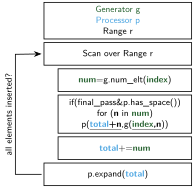

# Generator-Processor-Scan

## Synopsis

**Process a variable number of elements per index, in order. If necessary, restart from any index.**

## Mathematical Expression

Let $I = \{\text{start}, \ldots, \text{end}-1\}$ be an ordered set of indices, and let $E$ be the set of possible elements that a `Generator` $g$ can produce. Let $\mathcal{P}(E)$ denote the power set of $E$.

$$
g : I \to \mathcal{P}(E)
$$

For each index $i \in I$, let $S_i$ be the set produced by the `Generator` $g$:

$$
S_i = g(i) \subseteq E
$$

Because a set has no inherent order, suppose the elements of each $S_i$ are enumerated as $x_{i,j}$, where $0 \leq j < |S_i|$. The `Generator-Processor-Scan` pattern calls the `Processor` $p$ for each element, passing its sequential index and the element itself:

$$
p\left(
\sum_{k=\text{start}}^{i-1} |S_k| + j,\,
x_{i,j}
\right)
\qquad
\text{for each } i \in I,\ 0 \leq j < |S_i|
$$

## Requirements

!!! success ""

    - The `Generator` must be able to report how many elements it generates for each index (**countable**).
    - The order of `Generator` or `Processor` calls must not affect the result (**par-unseq**).
    - The `Generator` may be asked multiple times how many elements it generates for a given index.

## Guarantees

!!! abstract ""

    - The `Processor` receives **each element and its sequential index**.
    - Every element produced by the `Generator` is passed to the `Processor` **only once**.
    - If the `Processor` has enough capacity, processing requires **only one pass**.
    - After the first pass, the **total number of elements and the last processed index** are known.
    - The range can be chosen **independently**.

## Example

Consider the following code. It consists of a simple `Generator` whose `num_elt` function reports how many elements it generates for a given index. The elements themselves are generated by its call operator (`operator()`).

The `Processor` in this pseudocode is a `std::vector` that stores all generated elements.

```cpp
struct Generator {
  int num_elt(int index);
  T operator()(int index, int elt);
} g;

std::vector<T> v;
for (auto i = start; i < end; ++i)
{
  for (auto e = 0; e < g.num_elt(i); ++e)
    v.push_back(g(i, e));
}
```

Although this works on CPUs, `push_back` may need to allocate memory if the vector does not have enough capacity. This approach is not portable because many accelerators do not allow memory allocation in kernels; see [Restrictions](../restrictions.md#allocation-of-memory).

Even without the memory-allocation issue, the `for` loop cannot be ported directly to an accelerator. Parallel execution on accelerators does not guarantee a particular sequence of operations, as described in [Restrictions](../restrictions.md#parallel-execution-without-sequence).

To introduce the pattern, suppose we have an `accessible_vector` that is large enough to store all the elements we want to insert. We can then use a parallel scan to calculate each element's insertion position and generate and insert the elements in parallel (again, in pseudocode):

```cpp
struct Generator {
  int num_elt(int index);
  T operator()(int index, int elt);
} g;

device_vector<T> v;
current_processor_index = 0;

parallel_scan(auto i = start; i < end; ++i)
{
  num_elements = g.num_elt(i);
  for (auto e = 0; e < num_elements; ++e)
    v[current_processor_index + e] = g(i, e);

  current_processor_index += num_elements;
}
```

Here, the parallel scan sums the number of elements produced by the `Generator` to determine where each index's elements should be inserted. For an inclusive scan, the total after processing index $i$ is

$$
\text{current&#95;processor&#95;index}
=
\sum_{k=\text{start}}^{i} \text{num&#95;elements}(k)
$$

At the end of the parallel scan, `current_processor_index` contains the total number of elements processed.

But what if the `Processor` cannot process all the elements during the parallel scan?

After the parallel scan finishes, we know the total number of elements the `Processor` needs to handle. We can use this information to increase the size of the `device_vector`. If we also track the last scan index and the last position the `Processor` was able to process, we can restart the parallel scan and process the remaining elements.

In pseudocode, this looks like the following:

```cpp
struct Generator {
  int num_elt(int index);
  T operator()(int index, int elt);
} g;

device_vector<T> v;
current_processor_index = 0;
last_processed_scan_index = 0;
last_processed_position = 0;

parallel_scan(auto i = start; i < end; ++i)
{
  num_elements = g.num_elt(i);
  for (auto e = 0; e < num_elements; ++e)
  {
    int insert_index = current_processor_index + e;
    if (v.has_space(insert_index))
    {
      v[insert_index] = g(i, e);
      last_processed_position = max(current_processor_index, last_processed_position);
      last_processed_scan_index = max(i, last_processed_scan_index);
    }
  }
  current_processor_index += num_elements;
}

device_vector.resize(current_processor_index);

current_processor_index = 0;
parallel_scan(auto i = last_processed_scan_index; i < end; ++i)
{
  num_elements = g.num_elt(i);
  for (auto e = 0; e < num_elements; ++e)
  {
    v[last_processed_position + current_processor_index + e] = g(i, e);
  }
  current_processor_index += num_elements;
}
```

The following flowchart uses a `Range` to represent the set of indices $I$:

<figure markdown="span" style="width:50%">
{ width="100%" }
<figcaption>Counting two indices and inserting their elements in sequential order</figcaption>
</figure>

Some parallel-scan implementations may process an index multiple times. Therefore, we must ensure that we call the `Processor` $p$ only during the `final_pass`, when we know that the current index is being processed for the last time.

A reference implementation of this pattern using Kokkos can be found [here](https://github.com/PerformancePortablePatterns/performanceportablepatterns.github.io/tree/main/patterns/generator_processor_scan/kokkos). It has two versions. One version stores the index $i$ at which $S_i$ begins, allowing that index to be reused for easier indexing.
